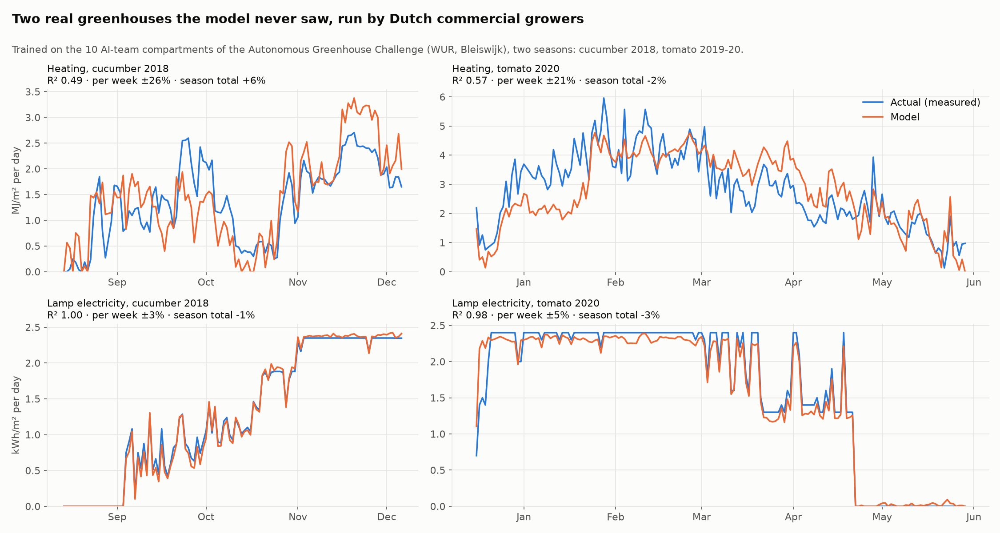
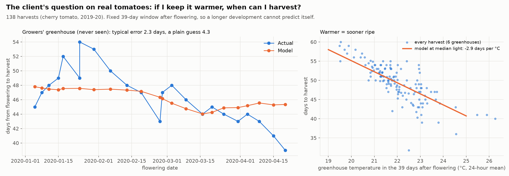
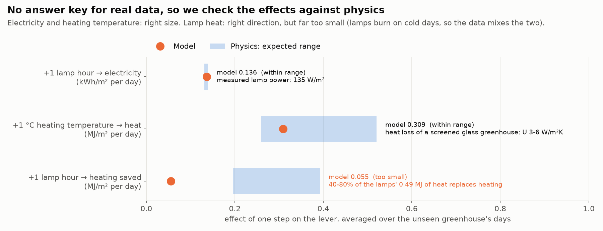

# Datasets for scenario prediction (ticket 1)

The client wants growers to ask *"what happens to my plants and my gas bill in week 44 if I
turn the greenhouse from 20 to 21 degrees today?"* (meeting 29-10). To build and test that, we
need data in which the **cause and effect is known**, plus real data to keep us honest.

| Dataset | Source | Rows | What it is for |
|---|---|---|---|
| `nursery.csv` | Simulator in `scripts/make_nursery.py` on real KNMI weather 2016-2025 | 711 batches | Building and **testing** scenario prediction: the simulator knows the true answer to every "what if" |
| `nursery_truth.json` | Same simulator | 5 scenarios | The answer key: average true effect of +1 °C, +2 h light, +200 ppm CO₂, +0.3 EC, +5 plants/m² |
| `nursery_faulty.csv` + `.faults.json` | Same data with injected problems | 711 + duplicates | Later ticket "what does the system do with bad data": stuck sensor, spikes, missing values, kWh-instead-of-m³, duplicate rows, each logged |
| `arable.csv` | **Real**: CBS 85636NED yields + KNMI daily weather per province | 1,448 (5 crops × 12 provinces × 1999-2025) | Reality check on public data, backtest exactly as the client proposed: train up to 2020, test 2021-2025 |
| `nursery_base.csv` + `compartments.csv` + `weather_rotterdam.csv` | The nursery data as **separate tables** | 711 + 16 + daily 2015-2025 | What the nursery manifests actually read: the weather window and the compartment attributes are joined in the manifest (see below) |
| `arable_base.csv` + `weather_provinces.csv` | The arable data as separate tables | 1,448 + daily per province | `arable-yield` joins the season temperature, rain and radiation from the daily weather of its province |

```bash
python scripts/make_nursery.py --faults      # ~4 s, downloads KNMI Rotterdam once
python scripts/make_arable.py                # ~4 s, downloads CBS + 12 KNMI stations once
predictor train                              # trains all use cases, incl. the 4 new ones
python scripts/check_scenarios.py            # model vs. answer key on unseen batches
```

**Connected tables.** `nursery.csv` and `arable.csv` stay as they are (the answer key, the plots and the metrics
comparison use them), but the use cases train on the split tables and connect them with `joins` in the manifest
([technical docs](technical.md#joining-datasets)). The join reproduces the old columns **exactly** (largest difference
0.0 for all eight columns); `predictor train` gives the same metrics for `arable-yield` and `nursery-harvest-weeks`, and a
0.04% different MAE for `nursery-gas` (the joined columns now come last, which changes LightGBM's tie-breaking). Five of the
arable weather columns (rain deficit, hot/frost/wet days, early-season rain) are still in the base table: they need
conditional counts and calendar-month windows that joins do not have yet.

Downloads are cached in `data/raw/` (git-ignored); after the first run everything works offline.
The tests use synthetic weather (`knmi.synthetic_daily`), so CI never needs the internet.

## 1. The nursery simulator (synthetic, with an answer key)

**One row = one crop batch ("teelt") in one greenhouse compartment.** That framing is the key
design choice for long-term prediction: the grower sets the climate at the start, and the
outcome (when is it ready, how many plants, how much gas) is a property of the batch. A
scenario is then simply the same row with a different setting, no step-by-step forecasting
into the future that piles up errors.

How a batch grows (week by week, until the plants reach 28 cm selling height):

- **Growth** = max growth × temperature optimum curve (22 °C) × light-use saturation (sun through
  the glass + lamps) × CO₂ enrichment × fertiliser (EC) optimum × density, plus batch luck and weekly noise.
- **Gas** = heat loss through the cover (U-value × (setpoint − outside)) minus solar gain minus lamp heat.
- **Electricity** = lamp power × hours. **Plants sold** = planted − losses (botrytis when cold,
  heat stress, weak plants in the dark, crowding, wrong EC, pests).
- **Weather is real** KNMI data (station Rotterdam, near the Westland), so cold snaps and the 2018 heat are in it.
- **Weather features are exogenous**: the average of the first 10 weeks after the start, so a scenario
  changes the decisions, never the weather the model sees.

**Realistic behaviour, on purpose.** The simulated grower reacts to the gas price. In 2022 the
greenhouses are colder and darker, and batches take 2.5 weeks longer. This creates exactly the
confounding a scenario model has to see through (correlation gas price vs. setpoint: −0.47).


**The answer key** (`nursery_truth.json`, average over all batches, same luck per batch):

| Scenario | Weeks to harvest | Plants sold | Gas | Electricity |
|---|---|---|---|---|
| +1 °C | −6.0% | +0.2% | **+4.0%** | −9.8% |
| +2 h light | −3.7% | +0.2% | **−24.6%** | +38.4% |
| +200 ppm CO₂ | −5.9% | +0.1% | −7.4% | −2.5% |
| +0.3 EC | +1.6% | −0.4% | +1.5% | +0.9% |
| +5 plants/m² | −2.0% | +7.0% | −2.7% | −1.8% |

Not all of these are obvious, and that is the point. +1 °C costs only 4% more gas per batch
because the batch is ready 6% sooner; extra lamps *save* gas because their heat stays in the
greenhouse. A rule of thumb misses this, a good scenario model must not.

The constants are plausible textbook horticulture, **not calibrated on a real grower**.
That is the first thing to adjust after the meeting on 12 November (see the questions at the end).

## 2. Results: does a model learn the true cause and effect?

Trained with the normal pipeline (`nursery-harvest-weeks`, `nursery-plants-sold`, `nursery-gas`),
then compared with the answer key on test batches the models never saw (Aug 2023-2025):


- **Direct growth effects are learned well**: +1 °C → harvest −6.1% true vs. −5.7% predicted; with
  3× more data (right panel) CO₂ → harvest is −6.0% vs. −6.1%, right direction for 95% of batches.
- **Indirect energy effects are underestimated**: lamp heat saving gas −25.5% true vs. −13.8%.
- **Temperature → gas gets the wrong sign with more data** (+1.9% true, −0.2% predicted): the
  confounding trap. High gas price, low setpoint and long batches all move together in the data.
- **More history helps**: harvest-weeks R² 0.75 → 0.85 going from 711 to 2,122 batches.

What this means for tickets 2-5:

1. Declare the expected direction per lever in the manifest (`effects`, ticket 2) and turn it into
   LightGBM monotone constraints, so "more heating = more gas" can never come out negative.
2. Physics-informed features (for example heating degree-weeks = setpoint − outside temperature)
   would make the gas effect much easier to learn; the scenario engine must then recompute them when a lever changes.
3. Always show the **answer-key check** (`scripts/check_scenarios.py`) when we change the model;
   it is our regression test for scenario quality.

## 3. Real data: arable yields (CBS + KNMI), an honest reality check

`scripts/make_arable.py` joins CBS table 85636NED (yield per hectare per crop per province) with
the KNMI daily data of one station per province, summarised per crop's growing season:
temperature, rain, radiation, **maximum precipitation deficit** (the drought measure Dutch
farmers use: cumulative evaporation − rain), hot days, frost days, early-season rain, wet days,
plus the average yield of the five years before (`yield_5y_avg`, never including the year itself).

Backtest as the client proposed: train 1999-2020, test 2021-2025 (`"test_from": "2021-01-01"`).


**The model does not beat the simple guess "same as the last 5 years"** (average error 4.22 vs.
3.47 t/ha). We double-checked this with yield deviations instead of absolute yields, per-crop
models, and monthly weather with leave-one-year-out validation: only silage maize shows some
weather signal (R² 0.22). Dutch arable yields at province level are driven more by irrigation,
varieties, disease and harvest conditions than by one weather station's season averages.

That is a useful outcome, not a failure:

- the system now **says so itself**: the manifest names a baseline column, the report and the
  dashboard show "Simple guess still wins" instead of a misleading "95% explained";
- it tells us what data a grower needs: farm-level measurements beat regional averages.


## 4. Real greenhouse data: Autonomous Greenhouse Challenge (WUR)

The arable data showed that regional averages are not enough. So we use **real greenhouse data with
the levers a grower turns**: the [Autonomous Greenhouse Challenge](https://www.wur.nl/en/research/plant/autonomous-greenhouse-challenge)
of Wageningen UR (CC0), two editions in the same six high-tech compartments in Bleiswijk:

| Edition | Crop | Period | Source |
|---|---|---|---|
| 1 | cucumber | Aug - Dec 2018 | [doi:10.4121/uuid:e4987a7b-04dd-4c89-9b18-883aad30ba9a](https://doi.org/10.4121/uuid:e4987a7b-04dd-4c89-9b18-883aad30ba9a) |
| 2 | cherry tomato | Dec 2019 - May 2020 | [doi:10.4121/uuid:88d22c60-21b3-4ea8-90db-20249a5be2a7](https://doi.org/10.4121/uuid:88d22c60-21b3-4ea8-90db-20249a5be2a7) |

Each season one compartment was run by Dutch commercial growers ("Reference"), five by AI teams.
The climate computer logs every 5 minutes; heating and electricity are booked per day; harvests
are registered per truss.

```bash
pip install -e '.[datasets]'                     # py7zr: edition 2 is a .7z archive (8 + 9 MB download)
python scripts/make_greenhouse_challenge.py      # -> data/greenhouse_days.csv (1,674 greenhouse-days)
                                                 #    data/greenhouse_harvests.csv (138 tomato harvests)
predictor train greenhouse-heating greenhouse-electricity greenhouse-harvest-timing
```

Three use cases, all with scenario levers. Each is tested on the **growers' compartment(s), which the
model never saw** (`training.test_group`); the model is chosen by leaving each other compartment out in
turn (group cross-validation):

| Use case | Question | Result on the growers' greenhouses |
|---|---|---|
| `greenhouse-heating` | heating energy per day | 2020: R² 0.57, per week ±21%, **season total −2%**; 2018: R² 0.49, per week ±26%, season total +6% |
| `greenhouse-electricity` | lamp electricity per day | R² 0.98-1.00, per week ±3-5%, season total −1 to −3% |
| `greenhouse-harvest-timing` | days from flowering to harvest (tomato) | typical error **2.3 days** (a plain guess: 4.3); **+1 °C = 2.9 days sooner** |



### Harvest timing: the client's question on real plants

"If I keep the greenhouse warmer from now on, when can I harvest?" For every tomato harvest the data
records how long the truss took from flowering to harvest (39-60 days). The model uses the greenhouse
temperature (24-hour mean) and light in the **first 39 days after flowering**. That window has a fixed
length on purpose: averaging over the whole development time would let a long development reach back
into colder weeks, so the temperature would partly predict itself (we first did that, see below).



Warmer is faster: about 2.9 days per °C, in line with tomato physiology (roughly 2-4 days per °C).
On the growers' greenhouse the model is off by 2.3 days on average, but it is too cautious: it follows
the trend from 48 to 45 days while the real range was 54 to 39. With six greenhouses in one season
that is what the data supports. CO₂ and humidity are left out: they mainly affect fruit size, not
ripening time, and with 115 training harvests they only added noise.

### No answer key, so we check against physics



- +1 °C heating temperature: +0.44 MJ/m² per day, which fits a screened glass greenhouse (U 3-6 W/m²K)
- +1 °C → harvest 2.9 days sooner: within the physiological range
- electricity per lamp hour: 0.124 vs. measured 0.132 kWh/m² (6% low; the two seasons have different lamps)
- lamp heat saving: right direction, **still too small** (0.10 vs. 0.19-0.38 MJ/m²). Lamps burn on cold,
  dark days, so in the data "more lamp hours" comes with "more heating". In euros: an extra lamp hour
  costs €0.008/m² in electricity, the missing heat saving is about €0.001-0.002/m².

### What we found doing this

- **Heating energy is not metered.** WUR computes it from the pipe temperatures:
  (rail − air) × 2.1 + (grow pipe − air) × 0.62 W/m². That explains why the minimum pipe temperatures
  are such strong inputs. Edition 1's readme says kWh/m², but recomputing from its 5-minute pipe data
  gives the same numbers in MJ/m² (ratio 1.09). Multiplying by 3.6 would have made 2018 five times too high.
- **One season is not enough to test over time.** Training on December-March and testing on April-May gave
  R² −0.59: trees cannot extrapolate to warmer weather than they saw. Testing on an unseen greenhouse is
  also the question a grower asks.
- **Declared effects threw out the best model** (a pipe-temperature coefficient had the wrong sign): R² 0.18.
  The linear model is now fitted with sign constraints, effects the data does not support are held at 0.
- **The second season helped**: in leave-one-greenhouse-out the heating error on the 2020 compartments
  dropped from 0.59 to 0.48-0.56 MJ/m² per day.
- **A tree model said +1 °C does nothing.** For harvest timing LightGBM had the lowest cross-validation
  error, but its prediction is flat between two splits: "+1 °C → 0 days" on every growers' day. With few
  groups the candidates are within noise of each other, so the trainer now takes the **simplest model
  within one standard error** of the best (a textbook rule, chosen before looking at the test). All
  three real-data models are linear now; heating and electricity give up a little (heating test MAE
  0.586 instead of the blend's 0.534) for smooth, explainable effects.
- **A redundant input broke the ONNX export.** Lamp power and crop always go together (one lamp type per
  season), so the constrained linear fit returned huge coefficients that cancel out; float32 serving
  was off by 3,000. A tiny ridge penalty keeps the solution unique.
- **Strategies nobody else used stay hard**: AI teams that ventilated at 30 °C or kept the greenhouse at
  23 °C are 40-90% off over a season. The growers' strategy is predicted within 2-6%.

This script is specific to this dataset (it aggregates the 5-minute logs to days and joins the files).
Generic aggregation, sensor preparation and joining datasets on time are separate team tickets; the
script can be replaced by them later.

## 5. Improvements to the pipeline found while doing this

| Problem found | Fix | Effect |
|---|---|---|
| The final model was trained on only 64% of the data; with a chronological split the most recent period (validation) was never learned | Choose on validation, then **refit the winner on train + validation** | Nursery harvest weeks R² 0.29 → 0.75; greenhouse MAE 0.76 → 0.54 °C; machine-failure F1 0.74 → 0.83 |
| ONNX parity check used a fixed absolute tolerance (0.0001); outputs like gas in m³ (up to 100,000) failed on harmless float32 rounding | Tolerance scales with the size of the output | Large real-world quantities can be trained |
| No way to backtest on a fixed period | `training.test_from` | Exact "train ≤ 2020, test 2021-2025" splits |
| "Better than a simple guess" only existed for 1-step forecasts, and showed negative percentages when the model lost | `training.baseline` + honest dashboard wording | The system admits when it adds no value |
| One season of real data: a chronological test only measures "can it extrapolate to May" | `training.test_group` holds out whole greenhouses | Tests what a grower asks: does it work for *my* greenhouse? |
| Declared effects threw out the best model on real data (one coefficient had the wrong sign) | Linear model fitted with sign constraints; unsupported effects held at 0 and reported | Real heating R² 0.18 → 0.57 on an unseen greenhouse |
| Validation on the last 20% in time while the test is "an unseen greenhouse" | With `test_group`: choose the model by leaving each training group out | Model choice answers the same question as the test |
| With few groups the best candidate is often noise, and a tree can show a lever as having no effect | Simplest model within one standard error of the best | Smooth effects (harvest +1 °C: 0 → −2.9 days) |
| Linear and trees each miss something on small data | New candidate: the blend (average of both) | Wins on arable yield (MAE 4.22 → 4.09) and plants sold (4,142 → 3,894) |
| pandas 3 stores dates in microseconds; interpolating on nanoseconds silently froze the gas price | Explicit conversion + a test on the 2022 crisis | Caught by our own sanity check |

## 6. Questions for the grower (12 November)

To calibrate the simulator, and later to replace it with his own data:

1. Which crop, how long is a batch, and what is "ready" (height, number of branches, flowering)?
2. Which levers does he really use: temperature, lighting hours, CO₂, EC, plant density, screens? Which are logged?
3. What does his climate computer export (Priva / Hoogendoorn / Ridder), and how many years back?
4. Gas and electricity per compartment or only for the whole company?
5. Typical losses, and what causes them (botrytis, heat, pests)?
6. Sales price per plant and his gas/electricity price, for the euro view in ticket 5.
