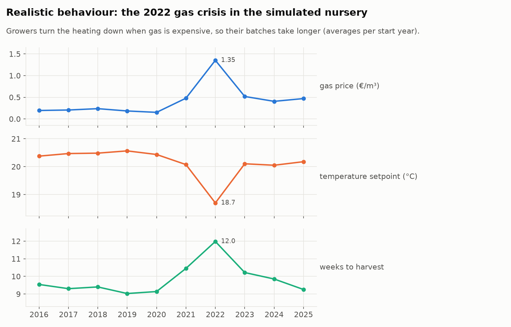
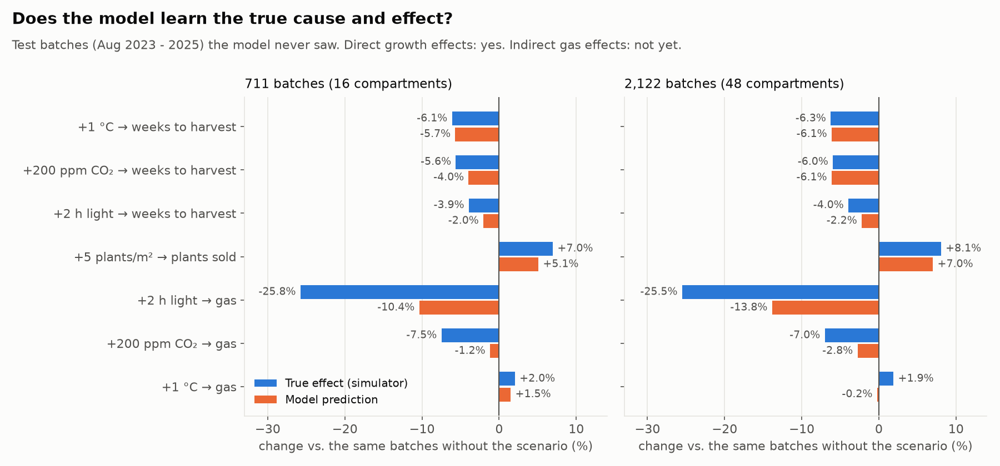
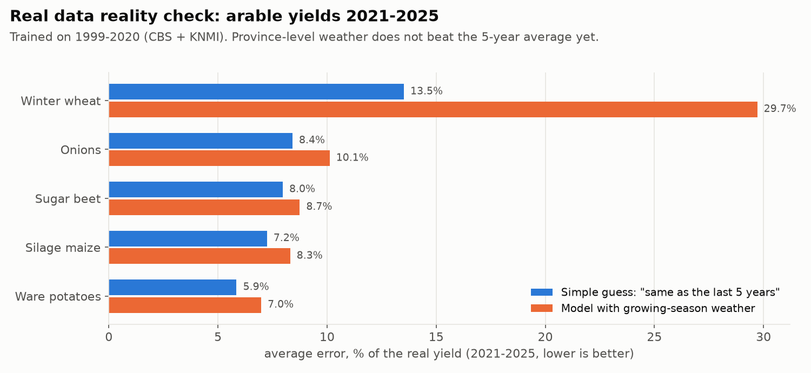
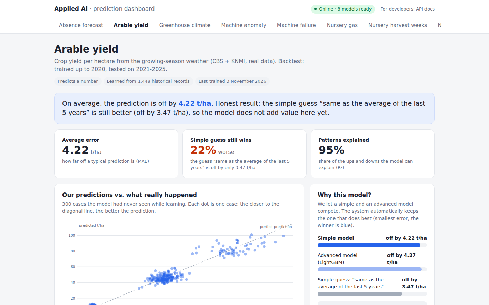

# Datasets for scenario prediction (ticket 1)

The client wants growers to ask *"what happens to my plants and my gas bill in week 44 if I
turn the greenhouse from 20 to 21 degrees today?"* (meeting 29-10). To build and test that, we
need data in which the **cause and effect is known**, plus real data to keep us honest.

| Dataset | Source | Rows | What it is for |
|---|---|---|---|
| `nursery.csv` | Simulator in `scripts/make_nursery.py` on real KNMI weather 2016-2025 | 711 batches | Building and **testing** scenario prediction: the simulator knows the true answer to every "what if" |
| `nursery_truth.json` | Same simulator | 5 scenarios | The answer key: average true effect of +1 °C, +2 h light, +200 ppm CO₂, +0.3 EC, +5 plants/m² |
| `nursery_faulty.csv` + `.faults.json` | Same data with injected problems | 711 + duplicates | Later ticket "what does the system do with bad data": stuck sensor, spikes, missing values, kWh-instead-of-m³, duplicate rows, each logged |
| `arable.csv` | **Real**: CBS 85636NED yields + KNMI daily weather per province | 1,448 (5 crops × 12 provinces × 1999-2025) | Reality check on public data, backtest exactly as the client proposed: train up to 2020, test 2021-2025 |

```bash
python scripts/make_nursery.py --faults      # ~4 s, downloads KNMI Rotterdam once
python scripts/make_arable.py                # ~4 s, downloads CBS + 12 KNMI stations once
predictor train                              # trains all use cases, incl. the 4 new ones
python scripts/check_scenarios.py            # model vs. answer key on unseen batches
```

Downloads are cached in `data/raw/` (git-ignored); after the first run everything works offline.
The tests use synthetic weather (`knmi.synthetic_daily`), so CI never needs the internet.

## 1. The nursery simulator (synthetic, with an answer key)

**One row = one crop batch ("teelt") in one greenhouse compartment.** That framing is the key
design choice for long-term prediction: the grower sets the climate at the start, and the
outcome (when is it ready, how many plants, how much gas) is a property of the batch. A
scenario is then simply the same row with a different setting, no step-by-step forecasting
into the future that piles up errors.

How a batch grows (week by week, until the plants reach 28 cm selling height):

- **Growth** = max growth × temperature optimum curve (22 °C) × light-use saturation (sun through
  the glass + lamps) × CO₂ enrichment × fertiliser (EC) optimum × density, plus batch luck and weekly noise.
- **Gas** = heat loss through the cover (U-value × (setpoint − outside)) minus solar gain minus lamp heat.
- **Electricity** = lamp power × hours. **Plants sold** = planted − losses (botrytis when cold,
  heat stress, weak plants in the dark, crowding, wrong EC, pests).
- **Weather is real** KNMI data (station Rotterdam, near the Westland), so cold snaps and the 2018 heat are in it.
- **Weather features are exogenous**: the average of the first 10 weeks after the start, so a scenario
  changes the decisions, never the weather the model sees.

**Realistic behaviour, on purpose.** The simulated grower reacts to the gas price. In 2022 the
greenhouses are colder and darker, and batches take 2.5 weeks longer. This creates exactly the
confounding a scenario model has to see through (correlation gas price vs. setpoint: −0.47).



**The answer key** (`nursery_truth.json`, average over all batches, same luck per batch):

| Scenario | Weeks to harvest | Plants sold | Gas | Electricity |
|---|---|---|---|---|
| +1 °C | −6.0% | +0.2% | **+4.0%** | −9.8% |
| +2 h light | −3.7% | +0.2% | **−24.6%** | +38.4% |
| +200 ppm CO₂ | −5.9% | +0.1% | −7.4% | −2.5% |
| +0.3 EC | +1.6% | −0.4% | +1.5% | +0.9% |
| +5 plants/m² | −2.0% | +7.0% | −2.7% | −1.8% |

Not all of these are obvious, and that is the point. +1 °C costs only 4% more gas per batch
because the batch is ready 6% sooner; extra lamps *save* gas because their heat stays in the
greenhouse. A rule of thumb misses this, a good scenario model must not.

The constants are plausible textbook horticulture, **not calibrated on a real grower**.
That is the first thing to adjust after the meeting on 12 November (see the questions at the end).

## 2. Results: does a model learn the true cause and effect?

Trained with the normal pipeline (`nursery-harvest-weeks`, `nursery-plants-sold`, `nursery-gas`),
then compared with the answer key on test batches the models never saw (Aug 2023-2025):



- **Direct growth effects are learned well**: +1 °C → harvest −6.1% true vs. −5.7% predicted; with
  3× more data (right panel) CO₂ → harvest is −6.0% vs. −6.1%, right direction for 95% of batches.
- **Indirect energy effects are underestimated**: lamp heat saving gas −25.5% true vs. −13.8%.
- **Temperature → gas gets the wrong sign with more data** (+1.9% true, −0.2% predicted): the
  confounding trap. High gas price, low setpoint and long batches all move together in the data.
- **More history helps**: harvest-weeks R² 0.75 → 0.85 going from 711 to 2,122 batches.

What this means for tickets 2-5:

1. Declare the expected direction per lever in the manifest (`effects`, ticket 2) and turn it into
   LightGBM monotone constraints, so "more heating = more gas" can never come out negative.
2. Physics-informed features (for example heating degree-weeks = setpoint − outside temperature)
   would make the gas effect much easier to learn; the scenario engine must then recompute them when a lever changes.
3. Always show the **answer-key check** (`scripts/check_scenarios.py`) when we change the model;
   it is our regression test for scenario quality.

## 3. Real data: arable yields (CBS + KNMI), an honest reality check

`scripts/make_arable.py` joins CBS table 85636NED (yield per hectare per crop per province) with
the KNMI daily data of one station per province, summarised per crop's growing season:
temperature, rain, radiation, **maximum precipitation deficit** (the drought measure Dutch
farmers use: cumulative evaporation − rain), hot days, frost days, early-season rain, wet days,
plus the average yield of the five years before (`yield_5y_avg`, never including the year itself).

Backtest as the client proposed: train 1999-2020, test 2021-2025 (`"test_from": "2021-01-01"`).



**The model does not beat the simple guess "same as the last 5 years"** (average error 4.22 vs.
3.47 t/ha). We double-checked this with yield deviations instead of absolute yields, per-crop
models, and monthly weather with leave-one-year-out validation: only silage maize shows some
weather signal (R² 0.22). Dutch arable yields at province level are driven more by irrigation,
varieties, disease and harvest conditions than by one weather station's season averages.

That is a useful outcome, not a failure:

- the system now **says so itself**: the manifest names a baseline column, the report and the
  dashboard show "Simple guess still wins" instead of a misleading "95% explained";
- it tells us what data a grower needs: farm-level measurements beat regional averages.



## 4. Improvements to the pipeline found while doing this

| Problem found | Fix | Effect |
|---|---|---|
| The final model was trained on only 64% of the data; with a chronological split the most recent period (validation) was never learned | Choose on validation, then **refit the winner on train + validation** | Nursery harvest weeks R² 0.29 → 0.75; greenhouse MAE 0.76 → 0.54 °C; machine-failure F1 0.74 → 0.83 |
| ONNX parity check used a fixed absolute tolerance (0.0001); outputs like gas in m³ (up to 100,000) failed on harmless float32 rounding | Tolerance scales with the size of the output | Large real-world quantities can be trained |
| No way to backtest on a fixed period | `training.test_from` | Exact "train ≤ 2020, test 2021-2025" splits |
| "Better than a simple guess" only existed for 1-step forecasts, and showed negative percentages when the model lost | `training.baseline` + honest dashboard wording | The system admits when it adds no value |
| pandas 3 stores dates in microseconds; interpolating on nanoseconds silently froze the gas price | Explicit conversion + a test on the 2022 crisis | Caught by our own sanity check |

## 5. Questions for the grower (12 November)

To calibrate the simulator, and later to replace it with his own data:

1. Which crop, how long is a batch, and what is "ready" (height, number of branches, flowering)?
2. Which levers does he really use: temperature, lighting hours, CO₂, EC, plant density, screens? Which are logged?
3. What does his climate computer export (Priva / Hoogendoorn / Ridder), and how many years back?
4. Gas and electricity per compartment or only for the whole company?
5. Typical losses, and what causes them (botrytis, heat, pests)?
6. Sales price per plant and his gas/electricity price, for the euro view in ticket 5.
