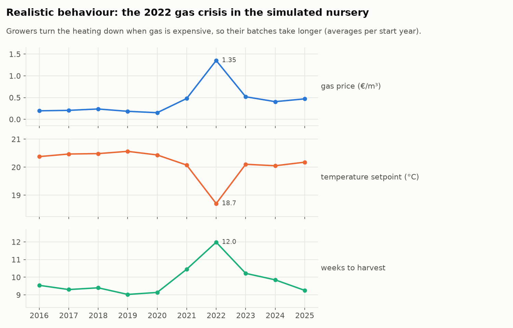
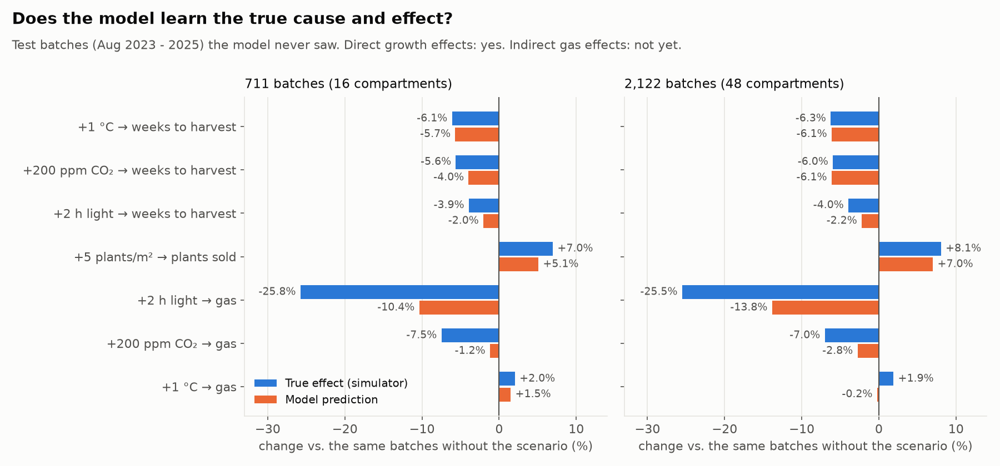
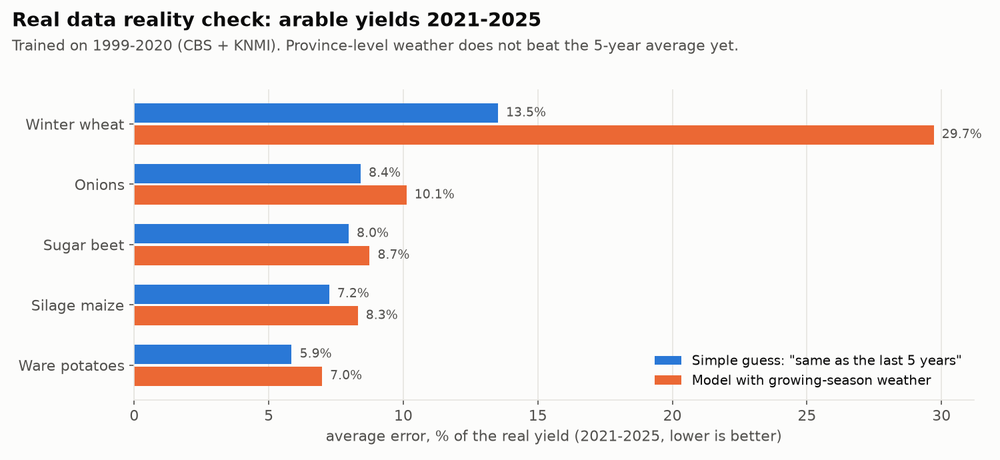
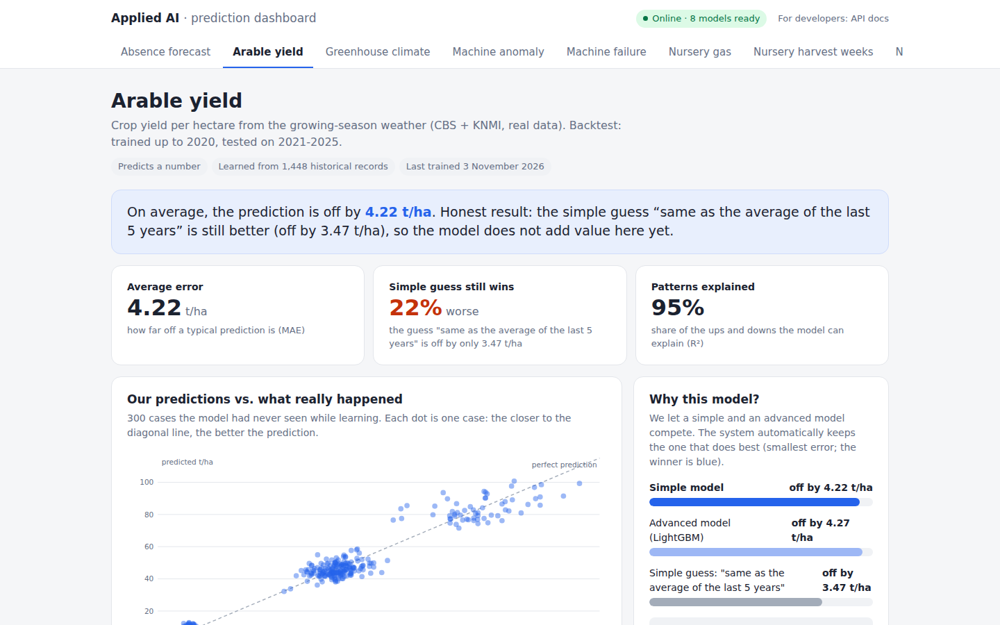
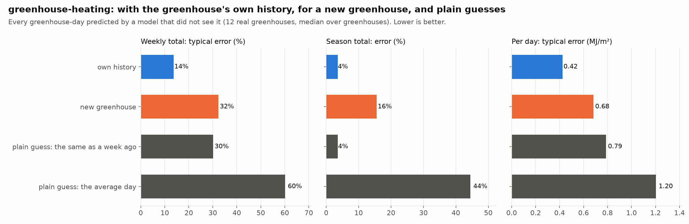
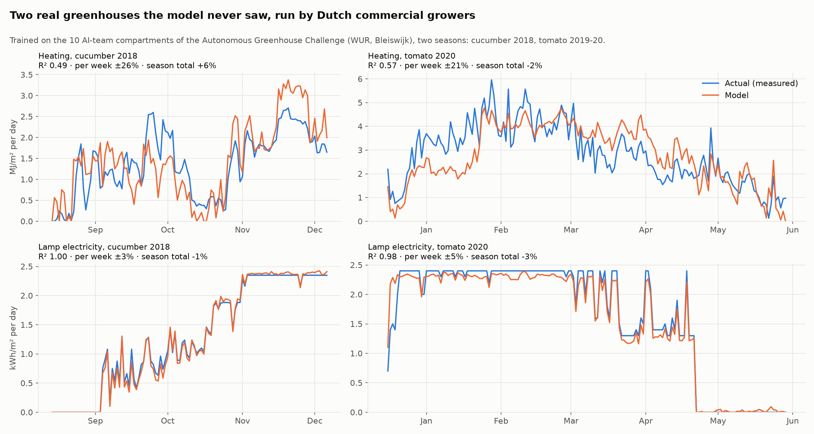
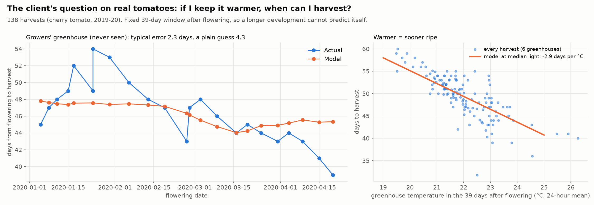
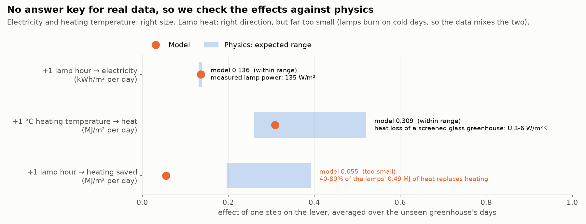
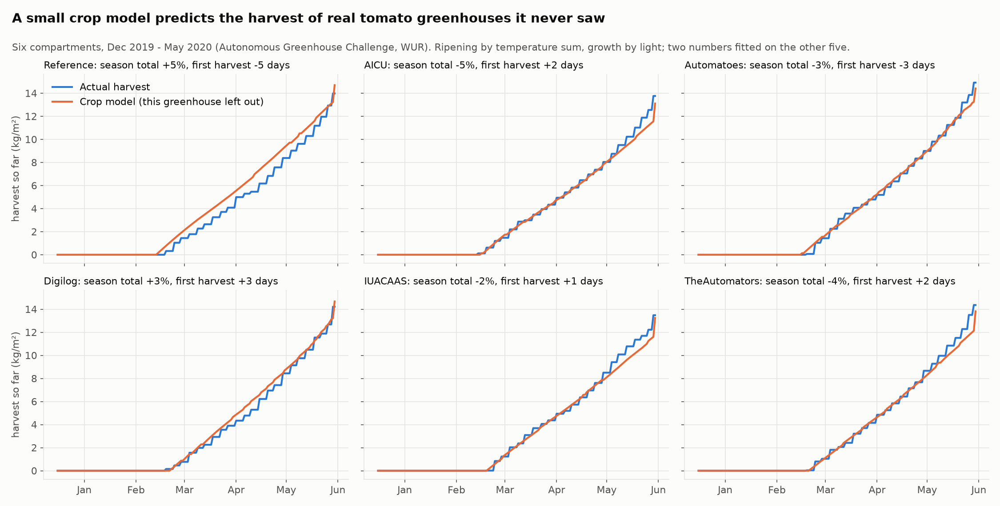

# Datasets for scenario prediction (ticket 1)

The client wants growers to ask *"what happens to my plants and my gas bill in week 44 if I
turn the greenhouse from 20 to 21 degrees today?"* (meeting 29-10). To build and test that, we
need data in which the **cause and effect is known**, plus real data to keep us honest.

| Dataset | Source | Rows | What it is for |
|---|---|---|---|
| `nursery.csv` | Simulator in `scripts/make_nursery.py` on real KNMI weather 2016-2025 | 711 batches | Building and **testing** scenario prediction: the simulator knows the true answer to every "what if" |
| `nursery_truth.json` | Same simulator | 5 scenarios | The answer key: average true effect of +1 °C, +2 h light, +200 ppm CO₂, +0.3 EC, +5 plants/m² |
| `nursery_faulty.csv` + `.faults.json` | Same data with injected problems | 711 + duplicates | Later ticket "what does the system do with bad data": stuck sensor, spikes, missing values, kWh-instead-of-m³, duplicate rows, each logged |
| `arable.csv` | **Real**: CBS 85636NED yields + KNMI daily weather per province | 1,448 (5 crops × 12 provinces × 1999-2025) | Reality check on public data, backtest exactly as the client proposed: train up to 2020, test 2021-2025 |
| `nursery_base.csv` + `compartments.csv` + `weather_rotterdam.csv` | The nursery data as **separate tables** | 711 + 16 + daily 2015-2025 | What the nursery manifests actually read: the weather window and the compartment attributes are joined in the manifest (see below) |
| `arable_base.csv` + `weather_provinces.csv` | The arable data as separate tables | 1,448 + daily per province | `arable-yield` joins the season temperature, rain and radiation from the daily weather of its province |

```bash
python scripts/make_nursery.py --faults      # ~4 s, downloads KNMI Rotterdam once
python scripts/make_arable.py                # ~4 s, downloads CBS + 12 KNMI stations once
predictor train                              # trains all use cases, incl. the 4 new ones
python scripts/check_scenarios.py            # model vs. answer key on unseen batches
```

**Connected tables.** `nursery.csv` and `arable.csv` stay as they are (the answer key, the plots and the metrics
comparison use them), but the use cases train on the split tables and connect them with `joins` in the manifest
([technical docs](technical.md#joining-datasets)). The join reproduces the old columns **exactly** (largest difference
0.0 for all eight columns); `predictor train` gives the same metrics for `arable-yield` and `nursery-harvest-weeks`, and a
0.04% different MAE for `nursery-gas` (the joined columns now come last, which changes LightGBM's tie-breaking). Five of the
arable weather columns (rain deficit, hot/frost/wet days, early-season rain) are still in the base table: they need
conditional counts and calendar-month windows that joins do not have yet.

Downloads are cached in `data/raw/` (git-ignored); after the first run everything works offline.
The tests use synthetic weather (`knmi.synthetic_daily`), so CI never needs the internet.

## 1. The nursery simulator (synthetic, with an answer key)

**One row = one crop batch ("teelt") in one greenhouse compartment.** That framing is the key
design choice for long-term prediction: the grower sets the climate at the start, and the
outcome (when is it ready, how many plants, how much gas) is a property of the batch. A
scenario is then simply the same row with a different setting, no step-by-step forecasting
into the future that piles up errors.

How a batch grows (week by week, until the plants reach 28 cm selling height):

- **Growth** = max growth × temperature optimum curve (22 °C) × light-use saturation (sun through
  the glass + lamps) × CO₂ enrichment × fertiliser (EC) optimum × density, plus batch luck and weekly noise.
- **Gas** = heat loss through the cover (U-value × (setpoint − outside)) minus solar gain minus lamp heat.
- **Electricity** = lamp power × hours. **Plants sold** = planted − losses (botrytis when cold,
  heat stress, weak plants in the dark, crowding, wrong EC, pests).
- **Weather is real** KNMI data (station Rotterdam, near the Westland), so cold snaps and the 2018 heat are in it.
- **Weather features are exogenous**: the average of the first 10 weeks after the start, so a scenario
  changes the decisions, never the weather the model sees.

**Realistic behaviour, on purpose.** The simulated grower reacts to the gas price. In 2022 the
greenhouses are colder and darker, and batches take 2.5 weeks longer. This creates exactly the
confounding a scenario model has to see through (correlation gas price vs. setpoint: −0.47).



**The answer key** (`nursery_truth.json`, average over all batches, same luck per batch):

| Scenario | Weeks to harvest | Plants sold | Gas | Electricity |
|---|---|---|---|---|
| +1 °C | −6.0% | +0.2% | **+4.0%** | −9.8% |
| +2 h light | −3.7% | +0.2% | **−24.6%** | +38.4% |
| +200 ppm CO₂ | −5.9% | +0.1% | −7.4% | −2.5% |
| +0.3 EC | +1.6% | −0.4% | +1.5% | +0.9% |
| +5 plants/m² | −2.0% | +7.0% | −2.7% | −1.8% |

Not all of these are obvious, and that is the point. +1 °C costs only 4% more gas per batch
because the batch is ready 6% sooner; extra lamps *save* gas because their heat stays in the
greenhouse. A rule of thumb misses this, a good scenario model must not.

The constants are plausible textbook horticulture, **not calibrated on a real grower**.
That is the first thing to adjust after the meeting on 12 November (see the questions at the end).

## 2. Results: does a model learn the true cause and effect?

Trained with the normal pipeline (the `nursery` use case: one manifest, one training run, one model per output;
here `weeks_to_harvest`, `plants_sold` and `gas_m3`. The old ids `nursery-harvest-weeks`, `nursery-plants-sold`,
`nursery-gas` and `nursery-electricity` still work as aliases of those outputs),
then compared with the answer key on test batches the models never saw (Aug 2023-2025):



- **Direct growth effects are learned well**: +1 °C → harvest −6.1% true vs. −5.7% predicted; with
  3× more data (right panel) CO₂ → harvest is −6.0% vs. −6.1%, right direction for 95% of batches.
- **Indirect energy effects are underestimated**: lamp heat saving gas −25.5% true vs. −13.8%.
- **Temperature → gas gets the wrong sign with more data** (+1.9% true, −0.2% predicted): the
  confounding trap. High gas price, low setpoint and long batches all move together in the data.
- **More history helps**: harvest-weeks R² 0.75 → 0.85 going from 711 to 2,122 batches.

What this means for tickets 2-5:

1. Declare the expected direction per lever in the manifest (`effects`, ticket 2) and turn it into
   LightGBM monotone constraints, so "more heating = more gas" can never come out negative.
2. Physics-informed features (for example heating degree-weeks = setpoint − outside temperature)
   would make the gas effect much easier to learn; the scenario engine must then recompute them when a lever changes.
3. Always show the **answer-key check** (`scripts/check_scenarios.py`) when we change the model;
   it is our regression test for scenario quality.

## 3. Real data: arable yields (CBS + KNMI), an honest reality check

`scripts/make_arable.py` joins CBS table 85636NED (yield per hectare per crop per province) with
the KNMI daily data of one station per province, summarised per crop's growing season:
temperature, rain, radiation, **maximum precipitation deficit** (the drought measure Dutch
farmers use: cumulative evaporation − rain), hot days, frost days, early-season rain, wet days,
plus the average yield of the five years before (`yield_5y_avg`, never including the year itself).

Backtest as the client proposed: train 1999-2020, test 2021-2025 (`"test_from": "2021-01-01"`).



**The model does not beat the simple guess "same as the last 5 years"** (average error 4.22 vs.
3.47 t/ha). We double-checked this with yield deviations instead of absolute yields, per-crop
models, and monthly weather with leave-one-year-out validation: only silage maize shows some
weather signal (R² 0.22). Dutch arable yields at province level are driven more by irrigation,
varieties, disease and harvest conditions than by one weather station's season averages.

That is a useful outcome, not a failure:

- the system now **says so itself**: the manifest names a baseline column, the report and the
  dashboard show "Simple guess still wins" instead of a misleading "95% explained";
- it tells us what data a grower needs: farm-level measurements beat regional averages.



## 4. Real greenhouse data: Autonomous Greenhouse Challenge (WUR)

The arable data showed that regional averages are not enough. So we use **real greenhouse data with
the levers a grower turns**: the [Autonomous Greenhouse Challenge](https://www.wur.nl/en/research/plant/autonomous-greenhouse-challenge)
of Wageningen UR (CC0), two editions in the same six high-tech compartments in Bleiswijk:

| Edition | Crop | Period | Source |
|---|---|---|---|
| 1 | cucumber | Aug - Dec 2018 | [doi:10.4121/uuid:e4987a7b-04dd-4c89-9b18-883aad30ba9a](https://doi.org/10.4121/uuid:e4987a7b-04dd-4c89-9b18-883aad30ba9a) |
| 2 | cherry tomato | Dec 2019 - May 2020 | [doi:10.4121/uuid:88d22c60-21b3-4ea8-90db-20249a5be2a7](https://doi.org/10.4121/uuid:88d22c60-21b3-4ea8-90db-20249a5be2a7) |

Each season one compartment was run by Dutch commercial growers ("Reference"), five by AI teams.
The climate computer logs every 5 minutes; heating and electricity are booked per day; harvests
are registered per truss.

```bash
pip install -e '.[datasets]'                     # py7zr: edition 2 is a .7z archive (8 + 9 MB download)
python scripts/make_greenhouse_challenge.py      # -> data/greenhouse_days.csv (1,674 greenhouse-days)
                                                 #    data/greenhouse_harvests.csv (138 tomato harvests)
predictor train greenhouse-heating greenhouse-electricity greenhouse-harvest-timing
```

Three use cases, all with scenario levers.

### How far can a grower rely on it? Two situations, next to a plain guess

A grower uses the model on **his own greenhouse, with his own history**. So heating and electricity are
tested on 2-week blocks held out of every compartment (`training.test_blocks`): the model knows the
greenhouse, not those weeks. The harder question, a greenhouse **without any history**, is reported next to it
(each compartment left out in turn). `python scripts/check_greenhouse.py` predicts every greenhouse-day
out of sample for both and compares with plain guesses:

| Heating (median over 12 greenhouses) | per day | per week | season total |
|---|---|---|---|
| **own history** | 0.42 MJ/m², R² 0.71 | **±14%** (worst greenhouse ±25%) | 3.5% |
| new greenhouse, no history | 0.68 MJ/m², R² 0.57 | ±32% (worst ±90%) | 16% |
| plain guess: the same as a week ago | 0.79 MJ/m² | ±30% | 3.6% |
| plain guess: the average day | 1.20 MJ/m² | ±60% | 44% |

| Lamp electricity | per day | per week | season total |
|---|---|---|---|
| **own history** | 0.07 kWh/m², R² 0.98 | **±2%** | 0.7% |
| new greenhouse, no history | 0.09 kWh/m², R² 0.99 | ±3% | 1.9% |
| plain guess: the same as a week ago | 0.32 kWh/m² | ±14% | 5.3% |



What this says, honestly:

- With its own history the heating model is about **twice as good per week as the plain guess** (±14% against
  ±30%). The published model reaches R² 0.84 on its held-out blocks, 47% better than "the same as a week ago".
- For a greenhouse without history, heating is **no better per week than "the same as a week ago"** (±32%
  against ±30%), and unusual strategies are far off. A new greenhouse should first log a season. (A scenario
  or a forecast months ahead cannot use last week's value, so there the model is still the only option.)
- Over a whole season "the same as a week ago" adds up right almost by construction (3.6%); the model with
  history matches that (3.5%) and, unlike the guess, can answer "what if".
- Scenario effects of the published heating model, through the real engine: +1 °C costs 0.39 MJ/m² per day
  (median; physics 0.26-0.52), never the wrong direction, and "no effect" on only 1-2% of days. Lamp heat
  saving is still too small (0.10 against 0.19-0.38).

`greenhouse-harvest-timing` (138 harvests, one season) keeps the test on the growers' compartment:
typical error **2.3 days** (a plain guess: 4.3), **+1 °C = 2.9 days sooner**.

The charts below show the earlier models on the growers' compartments as *new* greenhouses.



### Harvest timing: the client's question on real plants

"If I keep the greenhouse warmer from now on, when can I harvest?" For every tomato harvest the data
records how long the truss took from flowering to harvest (39-60 days). The model uses the greenhouse
temperature (24-hour mean) and light in the **first 39 days after flowering**. That window has a fixed
length on purpose: averaging over the whole development time would let a long development reach back
into colder weeks, so the temperature would partly predict itself (we first did that, see below).



Warmer is faster: about 2.9 days per °C, in line with tomato physiology (roughly 2-4 days per °C).
On the growers' greenhouse the model is off by 2.3 days on average, but it is too cautious: it follows
the trend from 48 to 45 days while the real range was 54 to 39. With six greenhouses in one season
that is what the data supports. CO₂ and humidity are left out: they mainly affect fruit size, not
ripening time, and with 115 training harvests they only added noise.

### No answer key, so we check against physics



- +1 °C heating temperature: +0.44 MJ/m² per day, which fits a screened glass greenhouse (U 3-6 W/m²K)
- +1 °C → harvest 2.9 days sooner: within the physiological range
- electricity per lamp hour: 0.124 vs. measured 0.132 kWh/m² (6% low; the two seasons have different lamps)
- lamp heat saving: right direction, **still too small** (0.10 vs. 0.19-0.38 MJ/m²). Lamps burn on cold,
  dark days, so in the data "more lamp hours" comes with "more heating". In euros: an extra lamp hour
  costs €0.008/m² in electricity, the missing heat saving is about €0.001-0.002/m².

### What we found doing this

- **Heating energy is not metered.** WUR computes it from the pipe temperatures:
  (rail − air) × 2.1 + (grow pipe − air) × 0.62 W/m². That explains why the minimum pipe temperatures
  are such strong inputs. Edition 1's readme says kWh/m², but recomputing from its 5-minute pipe data
  gives the same numbers in MJ/m² (ratio 1.09). Multiplying by 3.6 would have made 2018 five times too high.
- **One season is not enough to test over time.** Training on December-March and testing on April-May gave
  R² −0.59: trees cannot extrapolate to warmer weather than they saw. Testing on an unseen greenhouse is
  also the question a grower asks.
- **Declared effects threw out the best model** (a pipe-temperature coefficient had the wrong sign): R² 0.18.
  The linear model is now fitted with sign constraints, effects the data does not support are held at 0.
- **The second season helped**: in leave-one-greenhouse-out the heating error on the 2020 compartments
  dropped from 0.59 to 0.48-0.56 MJ/m² per day.
- **A tree model said +1 °C does nothing.** For harvest timing LightGBM had the lowest cross-validation
  error, but its prediction is flat between two splits: "+1 °C → 0 days" on every growers' day. With few
  groups the candidates are within noise of each other, so the trainer now takes the **simplest model
  within one standard error** of the best (a textbook rule, chosen before looking at the test). All
  three real-data models are linear now; heating and electricity give up a little (heating test MAE
  0.586 instead of the blend's 0.534) for smooth, explainable effects.
- **A redundant input broke the ONNX export.** Lamp power and crop always go together (one lamp type per
  season), so the constrained linear fit returned huge coefficients that cancel out; float32 serving
  was off by 3,000. A tiny ridge penalty keeps the solution unique.
- **Finer time steps did not help.** Training heating per hour instead of per day looked 27% better on one
  season, but not on two: 3-5% either way, which is noise. The same for day/night inputs and physics-based
  inputs (temperature gap, guaranteed heat from the minimum pipe temperatures). What did help is the
  greenhouse's own history: the remaining error is greenhouse-specific and cannot be read from the settings.
- **Calibrating on the first weeks does not work**: a greenhouse's first 4 weeks (August, or December) say
  little about the rest of the season. History has to cover the season.
- **Strategies nobody else used stay hard**: AI teams that ventilated at 30 °C or kept the greenhouse at
  23 °C are 40-90% off over a season. The growers' strategy is predicted within 2-6%.

This script is specific to this dataset (it aggregates the 5-minute logs to days and joins the files).
Generic aggregation, sensor preparation and joining datasets on time are separate team tickets; the
script can be replaced by them later.

### Harvest months ahead: a crop model fitted on the real greenhouses (`tomato-season`)

The grower's question is "if I change my settings now, what is my harvest in 5 months?". The real data
cannot answer that on its own: the six tomato greenhouses ended within 5% of each other, so there is
almost no "what if" in it. A model trained only on that data predicts the season yield worse than a
plain guess (12% off against 4%). So the cause and effect comes from crop knowledge, and the real data
only sets the numbers.

`scripts/tomato_crop.py` is a small crop model (a simplified cohort model, as used in greenhouse research):
new trusses set in proportion to temperature, a truss ripens after a temperature sum, the day's light
becomes fruit growth shared by the growing trusses, and a truss cannot grow faster than its sink strength.
Ripening (705 degree-days above 7.4 °C) is measured on 138 real harvests; two numbers are fitted on the
harvest curves. Tested by leaving each real greenhouse out in turn:

| | error on a greenhouse it never saw |
|---|---|
| season total | **3.7%** |
| harvest per month | 12% |
| first harvest | 2.7 days |



`scripts/make_tomato_season.py` runs that crop model for 3,655 decisions on real KNMI weather of ten years.
One row is one decision: a greenhouse some weeks into its season, the settings so far and the plan from now
on (temperature, lamp hours); the outputs are the harvest in the next 1, 3 and 5 months. The weather of
those months is not an input, because nobody knows it in advance, so the model's error is an honest margin
for a forecast months ahead. Tested on weather years it never saw (2023-2025):

| Harvest in the next | typical error | plain guess: a normal plan in an average year | better |
|---|---|---|---|
| 1 month | 0.09 kg/m² | 0.23 | 62% |
| 3 months | 0.36 kg/m² | 0.74 | 51% |
| 5 months | **0.68 kg/m² (5.5%)** | 1.05 | 35% |

The simulator is also the answer key (`python scripts/make_tomato_season.py --check`, scenarios through
the real engine on test decisions):

| Scenario from now on | harvest in 5 months: crop model | trained model | right direction |
|---|---|---|---|
| 4 lamp hours more | +4.6% | +5.2% | 100% |
| 4 lamp hours less | −4.5% | −5.5% | 100% |
| 1 °C warmer | +1.1% (next month: +4.9%) | +0.7% (next month: +3.6%) | 72% (next month: 84%) |
| 1 °C colder | −1.2% (next month: −5.1%) | −1.3% (next month: −4.4%) | 87% (next month: 88%) |

Limits, plainly: the crop model stands on one season of one crop (temperatures of 21-23.5 °C on average,
planted in December, about 5.5 months). Beyond that, for example a summer or a 10-month crop, it is crop
knowledge that speaks, not measured data. CO₂, humidity, diseases and fruit quality are not in it. The
euro value uses an assumed 2.50 €/kg. A grower's own harvest records would replace the calibration.

### The final test: another year, nothing tuned on it

Every number above comes from data we looked at while building. So we kept one test for the end: the
[4th Autonomous Greenhouse Challenge](https://doi.org/10.4121/fa102772-32db-4b30-bace-12f2016722ce)
(2024, CC BY 4.0): six compartments, dwarf tomato, September to November 2024. Other year, other teams,
other crop, other lamps. `python scripts/final_test.py` puts it in the same columns and sends every
greenhouse-day through the real API. How to map it (crop, pipe circuits, dimmable lamps) was written down
in the script before the first run. The models have no history of these greenhouses, so this is the hard
case: a new greenhouse in a new year.

Run once, on 16 November 2026, published models `greenhouse-heating` v13 and `greenhouse-electricity` v12:

| Heating (448 greenhouse-days, median over 6) | per day | per week | season total | days inside the 80% range |
|---|---|---|---|---|
| model | 0.47 MJ/m², R² 0.21 | ±62% | 60% off | 86% |
| plain guess: the same as a week ago | 0.48 MJ/m² | ±57% | 23% off | |
| plain guess: the average day of the training data | 1.37 MJ/m² | ±249% | 257% off | |

| Lamp electricity | per day | per week | season total | days inside the 80% range |
|---|---|---|---|---|
| model | 0.40 kWh/m², R² −2.85 | ±64% | 63% off | **16%** |
| plain guess: the same as a week ago | 0.13 kWh/m² | ±12% | 9% off | |

**The models did not pass.** What the test shows:

- **Heating is no better than "the same as a week ago"** for a new greenhouse in a new year, and over the
  season it is worse (60% against 23%). Two compartments that hardly heated are predicted 3 to 6 times too
  high. This confirms, more sharply, what the leave-one-greenhouse-out numbers already said: without the
  greenhouse's own history the heating model should not be relied on.
- **Electricity is 56-83% too high in every compartment**, a systematic error. These greenhouses have
  62.5 W/m² LED lamps; the training data has only 117 and 142 W/m². Electricity is lamp hours times lamp
  power, but a model that saw two lamp powers cannot learn a multiplication, and its tree half cannot go
  below the lowest power it saw. The R² of 0.98 on the earlier editions hid this, because every test there
  had a lamp power the model knew.
- **The system did say so**: every one of these electricity predictions carried the warning that an input
  was outside the training range. But the 80% range did not widen for it (16% inside). A range measured on
  the training greenhouses says nothing about a situation the training data does not contain.

**What we changed because of it** (so from here on the 2024 data is a check, not a final test):

1. **Electricity gets the physics.** The model's lamp input is now lamp use, `lamp_kwh_m2` = hours × installed
   power, and neither hours nor power on their own; as long as it saw raw hours it kept assuming the lamps it
   knew. It is a straight line by design (`model.algorithms`), because only that carries a proportional
   relation to lamps the data does not contain.
2. **No range where nothing was measured.** When an input is clearly outside the training data, the response
   has `"range": null` and a `range_note` saying which input, instead of a narrow range.
3. **Low certainty means "maybe a greenhouse I do not know".** Its range is at least as wide as the error
   measured on whole greenhouses the model never saw, and the message says so: *"If the model has no history
   of this greenhouse, expect it to be off by up to about 1.1 MJ/m²; log a season for this greenhouse first
   to rely on it."* On the 2024 data 98% of the heating days were already "low certainty"; now the number
   and the range agree with that.

The same 2024 data again, as a check:

| | per week | season total | days inside the 80% range |
|---|---|---|---|
| electricity, before | ±64% | 63% off | 16% |
| electricity, after | **±5%** | **4% off** | 100% |
| electricity, plain guess "the same as a week ago" | ±12% | 9% off | |
| heating, before and after (the model is unchanged) | ±62% | 60% off | 86% → 91% |
| heating, plain guess "the same as a week ago" | ±57% | 23% off | |

Electricity now beats the plain guess on greenhouses, a year and lamps it never saw. Heating is not better
and we did not try to make it look better: giving it lamp use instead of lamp hours made no difference on
the training greenhouses and was worse on 2024 (110% off), so that change was dropped. For heating the
honest product is the one above: it tells a grower without history not to rely on it.

The harvest models (`greenhouse-harvest-timing`, `tomato-season`) are not covered by this test.

## 5. Improvements to the pipeline found while doing this

| Problem found | Fix | Effect |
|---|---|---|
| The final model was trained on only 64% of the data; with a chronological split the most recent period (validation) was never learned | Choose on validation, then **refit the winner on train + validation** | Nursery harvest weeks R² 0.29 → 0.75; greenhouse MAE 0.76 → 0.54 °C; machine-failure F1 0.74 → 0.83 |
| ONNX parity check used a fixed absolute tolerance (0.0001); outputs like gas in m³ (up to 100,000) failed on harmless float32 rounding | Tolerance scales with the size of the output | Large real-world quantities can be trained |
| No way to backtest on a fixed period | `training.test_from` | Exact "train ≤ 2020, test 2021-2025" splits |
| "Better than a simple guess" only existed for 1-step forecasts, and showed negative percentages when the model lost | `training.baseline` + honest dashboard wording | The system admits when it adds no value |
| One season of real data: a chronological test only measures "can it extrapolate to May" | `training.test_group` holds out whole greenhouses | Tests what a grower asks: does it work for *my* greenhouse? |
| Declared effects threw out the best model on real data (one coefficient had the wrong sign) | Linear model fitted with sign constraints; unsupported effects held at 0 and reported | Real heating R² 0.18 → 0.57 on an unseen greenhouse |
| Validation on the last 20% in time while the test is "an unseen greenhouse" | With `test_group`: choose the model by leaving each training group out | Model choice answers the same question as the test |
| With few groups the best candidate is often noise, and a tree can show a lever as having no effect | Simplest model within one standard error of the best | Smooth effects (harvest +1 °C: 0 → −2.9 days) |
| The only test was "a greenhouse the model never saw", while a grower has his own history | `training.test_blocks`: hold out blocks of time in every group, report the new-group score next to it, publish the model on all rows | Heating per week ±32% → ±14% for a known greenhouse; both numbers in every report |
| A plain guess could only be a column that is also an input | `baseline.use_as_input: false` | "The same as a week ago" as a yardstick without leaking into scenarios |
| The real data holds no "what if" for yield (greenhouses within 5% of each other) | A crop model fitted and tested on the real greenhouses generates the seasons; the trained model is checked against it | Harvest 5 months ahead: 5.5% off, 35% better than a plain guess, effects match the answer key |
| Linear and trees each miss something on small data | New candidate: the blend (average of both) | Wins on arable yield (MAE 4.22 → 4.09) and plants sold (4,142 → 3,894) |
| pandas 3 stores dates in microseconds; interpolating on nanoseconds silently froze the gas price | Explicit conversion + a test on the 2022 crisis | Caught by our own sanity check |

## 6. Questions for the grower (12 November)

To calibrate the simulator, and later to replace it with his own data:

1. Which crop, how long is a batch, and what is "ready" (height, number of branches, flowering)?
2. Which levers does he really use: temperature, lighting hours, CO₂, EC, plant density, screens? Which are logged?
3. What does his climate computer export (Priva / Hoogendoorn / Ridder), and how many years back?
4. Gas and electricity per compartment or only for the whole company?
5. Typical losses, and what causes them (botrytis, heat, pests)?
6. Sales price per plant and his gas/electricity price, for the euro view in ticket 5.
