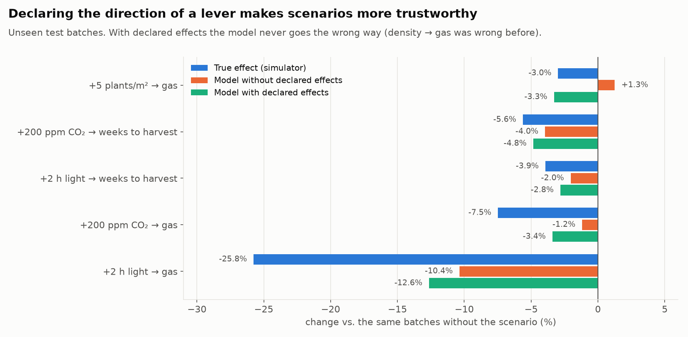
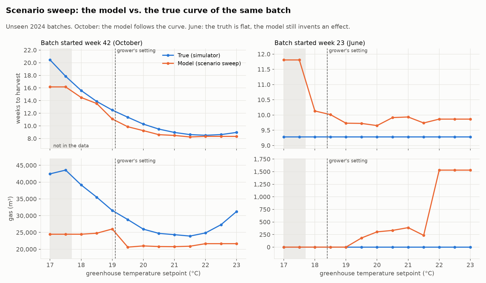

# Scenario prediction

The goal (meeting 29-10): a grower changes an input, for example the greenhouse temperature from
20 to 21 °C, and sees what that does to the outcome, for example the number of plants and the gas
used. This document grows with the scenario tickets.

| Ticket | Status |
|---|---|
| 1. Datasets for testing | done, see [datasets.md](datasets.md) |
| 2. Scenario variables in manifest.json | done |
| 3. Scenario input | done |
| 4. Calculate a scenario | **done** |
| 5. Difference base vs. scenario | |

## Scenario variables in `manifest.json` (ticket 2)

A use case declares which inputs a user may change (**levers**), within which range, and, only
where it always holds, in which direction a lever moves an output:

```jsonc
"scenario": {
  "levers": {
    "temp_setpoint_c": { "label": "Greenhouse temperature", "unit": "°C", "min": 17, "max": 23, "step": 0.5 },
    "light_hours": {
      "label": "Lamp hours", "unit": "h/day", "min": 0, "max": 18, "step": 0.5,
      "effects": { "gas_m3": "decreasing" }     // more lamp light never costs more gas (lamp heat)
    }
  },
  "outputs": {
    "gas_m3": { "label": "Gas use", "value_eur": -0.45 }   // positive = you sell it, negative = you pay for it
  }
}
```

Everything that is not a lever is **context** (weather, season, compartment): a scenario never changes it.

### What is checked, and when

| When | Check |
|---|---|
| Loading the manifest | `min` < `max`, `step` > 0, effects are `increasing`/`decreasing`, effects and outputs name a real output, a lever is not the target, time column, a dropped column or a forbidden (privacy) field, scenario only for use cases with a target, typos rejected |
| Training | every lever is a numeric or yes/no model input (not missing, constant or categorical) |
| Starting the API | every lever is an input of the *trained* model; a yes/no lever has range 0-1 step 1 |

### Declared effects are hard rules for the model

`effects` become **monotone constraints** in LightGBM: whatever the situation, turning that lever
up can only move the output the declared way. A linear model cannot be constrained, so it is
checked instead: if it contradicts a declared effect it is not eligible to win. The training report
lists the levers, the constraints, and any model that was excluded.

**Only declare what always holds.** In the simulated nursery, "more heating = more gas" is *not*
true per batch: a warmer batch is ready sooner, and 14% of batches use less gas in total. So
temperature is a lever without a declared effect, while lamp light, CO₂ and plant density do have
one (`tests/test_scenario_variables.py` checks every declared effect against the simulator's answer key).

This already matters in the nursery gas model: the linear baseline learned "more CO₂ = more gas",
because growers dose CO₂ in winter, exactly when they heat. That is a correlation, not an effect, so
the linear model was excluded and the constrained LightGBM won.

The result on test batches the models never saw:



- plant density → gas had the **wrong sign** (+1.3% instead of −3.0%); now −3.3%
- CO₂ → weeks to harvest: right direction for 96% of batches (was 78%), the rest "no change", never the opposite
- accuracy did not suffer: harvest-weeks R² 0.749 → 0.761, gas MAE 3,230 → 3,174 m³

Indirect effects (lamp heat saving gas) are still underestimated; better features for that are
input for ticket 4.

### What clients get: `GET /models/{id}` → `scenario`

```json
{
  "levers": [
    { "name": "light_hours", "label": "Lamp hours", "unit": "h/day", "kind": "number",
      "min": 0, "max": 18, "step": 0.5, "effects": { "gas_m3": "decreasing" },
      "training_range": [0, 18], "beyond_training_data": false }
  ],
  "outputs": [ { "name": "gas_m3", "label": "Gas use", "unit": "m³", "value_eur": -0.45 } ],
  "constraints": { "effects": { "light_hours": "decreasing", "co2_ppm": "decreasing", "plant_density_m2": "decreasing" },
                   "excluded_candidates": { "linear_regression": ["co2_ppm should be decreasing but the model says increasing"] } }
}
```

`beyond_training_data` warns when a lever's range goes past what the model has seen: tree models
predict a flat line there, so a scenario at the edge looks like "no effect".

## Scenario input (ticket 3)

`POST /models/{id}/scenario/check` takes the current situation (`base`) and up to 20 scenarios,
and returns exactly what would be calculated, or one 422 that lists every problem at once.

```jsonc
POST /models/nursery-gas/scenario/check
{
  "base": { "record_id": "K07 week 42", "features": { "temp_setpoint_c": 19, "light_hours": 7.5, "...": "all model inputs" } },
  "scenarios": [
    { "name": "1 degree warmer",       "changes": { "temp_setpoint_c": { "delta": 1 } } },
    { "name": "more light, less heat", "changes": { "light_hours": { "set": 12 }, "temp_setpoint_c": 18 } }
  ]
}
```

A change is `{"set": value}`, `{"delta": change}`, or a plain number (short for `set`). The answer
repeats the base and gives, per scenario, what changed and the complete input row:

```jsonc
{ "name": "1 degree warmer",
  "changes": [ { "lever": "temp_setpoint_c", "label": "Greenhouse temperature", "unit": "°C", "from": 19, "to": 20 } ],
  "features": { "temp_setpoint_c": 20, "light_hours": 7.5, "...": "..." },
  "warnings": [] }
```

| Situation | Result |
|---|---|
| a change to something that is not a lever (weather, season) | 422: "'outside_temp_avg_c' cannot be changed in a scenario; you can change: ..." |
| a value outside the lever's `min`/`max` | 422: "temp_setpoint_c would become 27 (19 +8), outside the allowed range 17 - 23" |
| a yes/no lever set to 0.5 | 422 from the feature schema |
| the base breaks the schema or the privacy policy | 422, with `"scenario": null` |
| two scenarios with the same name, none, more than 20, `set` and `delta` together, NaN | 422 |
| a value beyond what the model has seen | 200 with a warning (tree models predict a flat line there) |
| a scenario that changes nothing | 200 with a warning |
| a use case without levers | 422: "add a 'scenario' section to its manifest" |

Every error names the scenario and the field, so a client can put the message next to the right slider.
The endpoint only resolves and checks; ticket 4 calculates the same request with the model.

## Calculating scenarios (ticket 4)

Two endpoints, both on top of the scenario input of ticket 3 (same checks, same errors):

| Endpoint | What it does |
|---|---|
| `POST /models/{id}/scenario` | the same request as `/scenario/check`; calculates the base and every scenario in one batch |
| `POST /models/{id}/scenario/sweep` | slides one lever over a range (default: its whole range in its own step, at most 201 points) and calculates every point: a line instead of one number |

```jsonc
POST /models/nursery-gas/scenario/sweep
{ "base": { "features": { "...": "the current batch" } }, "lever": "temp_setpoint_c", "from": 17, "to": 23, "step": 0.5 }

// answer (shortened)
{ "lever": { "name": "temp_setpoint_c", "label": "Greenhouse temperature", "training_range": [17.7, 24.3], "...": "..." },
  "base": { "value": 19, "outputs": { "gas_m3": { "value": 25337.2 } } },
  "points": [ { "value": 17, "outputs": { "gas_m3": { "value": 23782.0 } }, "beyond_training_data": true }, "..." ] }
```

Outputs are keyed by output name (`outputs.gas_m3.value`; classification adds `probabilities`), so the
answer keeps its shape when a use case gets more outputs. The base of a scenario gives exactly the
same number as `/predict` for the same input (tested).

### Physical limits: `target_min` / `target_max`

The first sweeps showed a model predicting **negative gas use** for a summer batch. A use case can now
declare the limits of its output (`"target_min": 0` in the nursery manifests). Every prediction, in
`/predict`, batches, scenarios and sweeps alike, stays within them, with a warning when the model
went past the limit. The training metrics use the same limits, so the report matches what the API returns
(nursery gas MAE 3,174 → 3,027 m³).

### How good are the calculated scenarios? (the answer key)

`python scripts/check_scenarios.py --sweeps` sweeps every lever over its whole range **through the
real scenario engine** for 60 unseen test batches and compares each curve with the simulator's true
curve for the same batch.

| Output | Temperature | Lamp light | CO₂ | EC | Plant density |
|---|---|---|---|---|---|
| Weeks to harvest | **0.92** | **0.96** | **0.96** | 0.74 | **0.97** |
| Gas | 0.68 | **0.88** | **0.81** | 0.39 | **0.83** |
| Plants sold | 0.54 | 0.83 | 0.27 | 0.58 | **0.97** |

*Correlation between the predicted and the true curve, for batches where the lever really matters
(1 = same shape). Plants sold barely react to most levers (±0.2%), so low numbers there mean "tiny effect", not "wrong".*



**Known limitation:** where a lever has no real effect (temperature in summer: the sun keeps the
greenhouse warm anyway), the model still invents one, about a week for harvest time and 4-16% of the
normal gas level (before the output limits this was up to 51%). The test suite guards this so it cannot get
silently worse. Better features for the season are input for later work.

### Not in this ticket

- Several outputs in one use case (the multi-output tickets): `outputs` and `effects` are already
  keyed by output name, so they work unchanged once a use case has more than one target.
- The difference between base and scenario, in money and with the margin of error (ticket 5).
